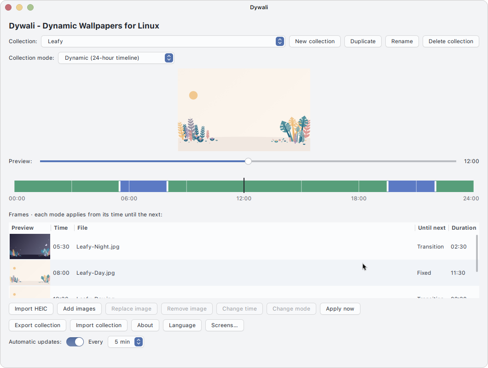
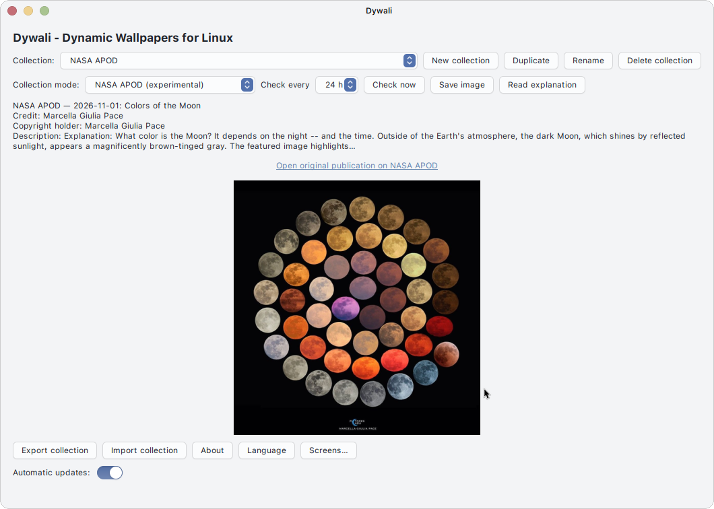
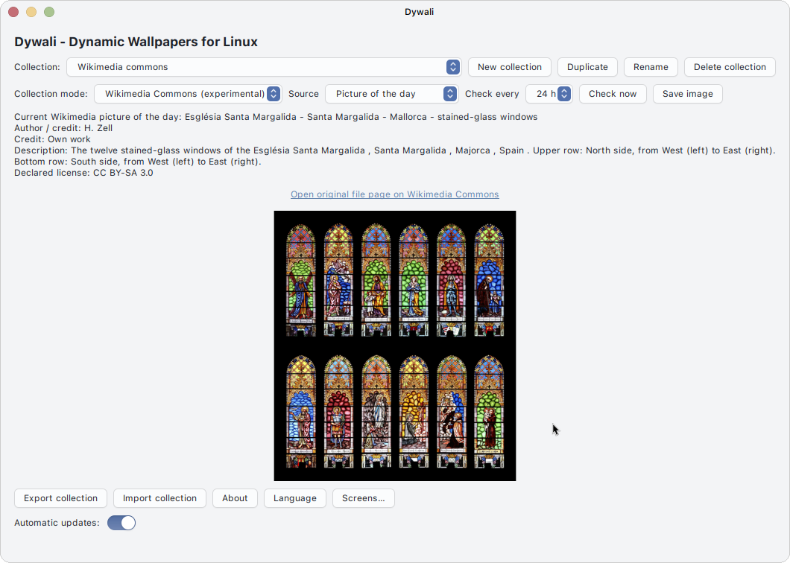

# Dywali — Dynamic Wallpapers for Linux

Dywali is a GTK 3 desktop application for creating and applying scheduled wallpaper collections. The `public-1.0` edition includes local collections and slideshows, NASA Astronomy Picture of the Day (APOD), and Wikimedia Commons.

## Screenshots

### Dynamic wallpaper collections

Create dynamic collections with a 24-hour timeline of fixed-image periods and transitions between images.



### NASA Astronomy Picture of the Day

Browse and view the astronomy image of the day, with its available credits and a link to the original publication.



### Wikimedia Commons

Browse Wikimedia Commons images and view the available author, license, and source information.



The project has been tested on Debian 13 with XFCE on X11. Other distributions and Wayland sessions have not been verified.

## Features

- Build daily timelines from local images, with smooth transitions and fixed-image periods.
- Create, edit, import, and export collections; run local images as a shuffled slideshow.
- Apply wallpapers to supported XFCE displays and workspaces.
- Browse NASA APOD's daily image and Wikimedia Commons' picture of the day or featured pictures.
- Keep provider images and status locally cached. Online providers are optional; local collections do not require provider access.
- Use the interface in English or Spanish.

## Requirements

- Python 3, GTK 3, PyGObject, and Pillow.
- XFCE/X11 with `xfconf-query` and XRandR (`xrandr`) available for display discovery and wallpaper application.
- A running `systemd --user` manager for automatic scheduled updates. Dywali does not enable a timer automatically on a clean installation; enable scheduling in the application when wanted.

On Debian 13, install the runtime packages with:

```sh
sudo apt install python3 python3-gi gir1.2-gtk-3.0 python3-pil xfce4 xfconf x11-xserver-utils
```

The package manager may report that some XFCE components are already installed. Dywali itself is installed as the logged-in user; do not run its installer with `sudo`.

## Install / Instalación

### English

Download and extract `Dywali-1.0.1-public.zip`. This is an installable source-code package, not a DEB package or a standalone executable. Run the installer from the extracted directory:

```sh
unzip Dywali-1.0.1-public.zip
cd Dywali-1.0.1
sh ./install.sh
```

### Español

Descarga y extrae `Dywali-1.0.1-public.zip`. Es un paquete de código fuente instalable, no un paquete DEB ni un ejecutable autónomo. Ejecuta el instalador desde el directorio extraído:

```sh
unzip Dywali-1.0.1-public.zip
cd Dywali-1.0.1
sh ./install.sh
```

Launch it with:

```sh
~/.local/bin/dywali
```

The installer checks its dependencies and files before changing the installation. A clean install creates the sample Leafy collection but leaves automatic scheduling disabled. Existing recognized Dywali installations can be updated with the same installer; collections and user data are preserved. If an existing active collection uses a provider omitted from `public-1.0`, its settings are retained and the incompatible timer is left stopped. Select a supported collection before enabling scheduling again.

## Basic use

Choose or create a collection, select its mode, then add local images or choose an online provider. Dynamic collections use a 24-hour timeline; `blend` transitions between adjacent images and `hold` keeps an image fixed until the next point. A local slideshow changes images at its configured interval.

For automatic updates, configure the interval in Dywali and enable its user timer from the application. The timer runs as the logged-in user. A working XFCE wallpaper property must already exist for each display; if a display is not available to Dywali, initialize it once in XFCE's Desktop Settings → Background.

## Public image providers

- **NASA APOD:** retrieves the daily astronomy image and its available title, explanation, credit, and copyright metadata. APOD can contain third-party works; NASA origin does not mean every image has the same reuse terms.
- **Wikimedia Commons:** offers the picture of the day and featured pictures. Authors, credits, and license details vary by file. Check the original Commons file page and follow that file's conditions before reusing an image.

Dywali displays source information when provided by the service. Metadata may be incomplete; consult the original provider page when attribution or reuse terms matter. Provider availability and image selection are controlled by the respective services.

## Privacy and network behavior

Dywali has no telemetry feature identified in this edition. Local collections can be used without contacting the image providers. Selecting, refreshing, or scheduling an online provider causes requests to that provider and its image hosts. Those services necessarily receive normal connection data such as your IP address, request time, and request headers. Dywali does not upload local collection files as part of these provider requests.

NASA APOD uses `DEMO_KEY` by default. You may set `DYWALI_NASA_API_KEY` in the environment to use another NASA API key. Wikimedia requests use a Dywali user-agent; an optional `DYWALI_CONTACT` environment variable can add a project contact value. Do not put private information in that value. Opening provider, support, or donation links contacts the corresponding website through your desktop browser.

Configuration is stored under `~/.config/dywali/`, provider state under `~/.local/state/dywali/`, and cached/generated images under `~/.cache/dywali/`. Collection images remain at their chosen paths.

## Update and uninstall / Actualización y desinstalación

### English

To update, use the installer supplied with the newer public package. It preserves existing collections, configuration, images, and state unless a preflight check refuses an unsafe or conflicting target.

Keep the extracted `Dywali-1.0.1/` directory so you can run the uninstaller later. The uninstaller is not copied into the installed application directory. From the extracted directory, run:

```sh
sh ./uninstall.sh
```

The uninstaller removes recognized Dywali application files and its user timer. By default it **does not delete** collections, configuration, provider caches, generated wallpaper files, or state. Review and remove those user data directories yourself only if you explicitly want to discard them. Files the uninstaller cannot identify as Dywali-owned are left in place.

### Español

Para actualizar, usa el instalador incluido en el nuevo paquete público. Conserva las colecciones, la configuración, las imágenes y el estado existentes, salvo que una comprobación previa rechace un destino inseguro o en conflicto.

Conserva el directorio extraído `Dywali-1.0.1/` para poder ejecutar después el desinstalador. El desinstalador no se copia al directorio de la aplicación instalada. Desde el directorio extraído, ejecuta:

```sh
sh ./uninstall.sh
```

El desinstalador elimina los archivos reconocidos de Dywali y su temporizador de usuario. De forma predeterminada **no elimina** colecciones, configuración, cachés de proveedores, fondos generados ni estado. Si quieres descartar esos datos, revísalos y elimínalos por separado. Los archivos que no puede identificar como propios de Dywali se conservan.

## Limitations

- Debian 13 with XFCE/X11 is the tested environment; Wayland and other distributions are unverified.
- Wallpaper application depends on XFCE's existing desktop properties and XRandR display discovery.
- Automatic scheduling requires a functioning `systemd --user` session. A clean installation does not activate it automatically.
- NASA and Wikimedia require network access and may rate-limit, change interfaces, omit metadata, or be temporarily unavailable. Local collections remain usable without those services.

## License and credits

Dywali's own code is distributed under **GNU GPL version 3 only** (`GPL-3.0-only`); see [`LICENSE`](LICENSE). Third-party resource credits and qualifications are listed in [`THIRD-PARTY-NOTICES.md`](THIRD-PARTY-NOTICES.md). The licenses of system dependencies remain their respective owners' terms.

The bundled Leafy JPEGs visually correspond to the upstream Dawn and Moon variants; see the comparison qualification and pinned source references in the notice file.

## Support and donations

Project identity: **roger181078**. Donations: [Buy Me a Coffee](https://buymeacoffee.com/reminderclock). No public source repository or support email is specified here.
